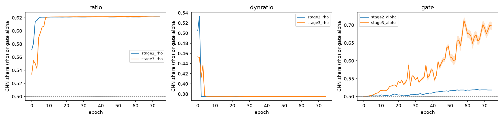

# LW-CTrans adaptive channel split on AISD

Our runs: fold 0 of nnU-Net 5-fold split (272 train / 68 val), 150 epochs, one run per model. Test set: 52 held-out AISD cases, predicted with checkpoint_best. The paper row uses 5-fold CV and is not directly comparable.

| Model | Params (M) | Val Dice (%) | Test Dice (%) | Test IoU (%) | Test HD95 (mm) | Test Precision (%) | Test Sensitivity (%) |
|---|---|---|---|---|---|---|---|
| baseline_50_50 | 2.1535 | 40.93 ± 29.51 | 44.97 ± 23.21 | 32.00 ± 20.18 | 49.55 ± 25.68 | 40.40 ± 25.97 | 66.93 ± 19.34 |
| ratio | 2.2599 | 37.19 ± 27.95 | 41.83 ± 21.71 | 28.95 ± 18.40 | 50.30 ± 24.62 | 34.26 ± 23.46 | 73.56 ± 15.16 |
| dynratio | 2.2651 | 38.08 ± 28.41 | 39.69 ± 23.71 | 27.66 ± 19.82 | 52.60 ± 25.48 | 33.53 ± 26.04 | 70.92 ± 18.63 |
| gate | 2.1562 | 43.00 ± 29.96 | 49.77 ± 21.16 | 35.79 ± 19.09 | 42.12 ± 25.94 | 49.31 ± 26.07 | 63.01 ± 19.37 |
| paper_50_50 | 2.08 | | 62.35 ± 19.51 | | | | |

## Paired comparison against our 50:50 baseline (per-case Dice, percentage points)

| Model | Split | Pairs | Mean diff | Median diff | Wins / Losses | Wilcoxon p |
|---|---|---|---|---|---|---|
| ratio | val | 68 | -3.74 | -3.03 | 19 / 47 | 0.0001 |
| ratio | test | 52 | -3.14 | -2.66 | 16 / 36 | 0.0009 |
| dynratio | val | 68 | -2.85 | -2.27 | 19 / 46 | 0.0001 |
| dynratio | test | 52 | -5.28 | -4.63 | 10 / 42 | 0.0000 |
| gate | val | 68 | +2.07 | +1.07 | 43 / 20 | 0.0010 |
| gate | test | 52 | +4.80 | +3.91 | 41 / 11 | 0.0000 |

## Learned split

- **ratio**: final={"stage2": {"rho": 0.621161937713623, "conv_channels": 39.754364013671875, "dim": 64, "tau": 0.25}, "stage3": {"rho": 0.6223899126052856, "conv_channels": 79.66590881347656, "dim": 128, "tau": 0.25}}; last validation epoch={"epoch": 74.0, "stage2_rho_mean": 0.621161937713623, "stage2_rho_std": 0.0, "stage3_rho_mean": 0.6223898530006409, "stage3_rho_std": 5.960464477539063e-08, "stage2_tau": 0.25, "stage3_tau": 0.25}
- **dynratio**: final={"stage2": {"rho_bias": 0.3750102443054857, "tau": 0.25}, "stage3": {"rho_bias": 0.3753410904901102, "tau": 0.25}}; last validation epoch={"epoch": 74.0, "stage2_rho_mean": 0.37501031160354614, "stage2_rho_std": 5.960464477539063e-08, "stage3_rho_mean": 0.3753420114517212, "stage3_rho_std": 5.68146731438901e-07, "stage2_tau": 0.25, "stage3_tau": 0.25}
- **gate**: final={"stage2": {"dim": 64}, "stage3": {"dim": 128}}; last validation epoch={"epoch": 74.0, "stage2_alpha_mean": 0.51806640625, "stage2_alpha_sample_std": 0.0, "stage2_alpha_channel_sample_std": 0.003284454345703125, "stage3_alpha_mean": 0.69775390625, "stage3_alpha_sample_std": 0.01103973388671875, "stage3_alpha_channel_sample_std": 0.01377105712890625}

